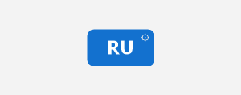
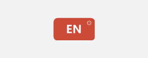
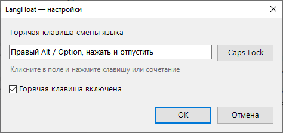

# LangFloat

Небольшая программа для Windows 10: показывает текущую раскладку клавиатуры на плашке, которая висит поверх всех окон, и переключает раскладку по горячей клавише.

<p>
  
  
</p>

## Возможности

- Плашка с языком активного окна: RU синяя, EN красная, UK жёлтая, остальные серые.
- Горячая клавиша смены раскладки. Можно выбрать обычную клавишу, сочетание вроде `Ctrl + Shift + Z` или одиночное нажатие модификатора, например правого Alt.
- Плашка не забирает фокус, её нет на панели задач и в Alt + Tab.
- Плашку можно перетащить мышью, позиция запоминается.
- Плашка переходит за вами на любой виртуальный рабочий стол.
- Работает с приложениями на WebView2, например с новым Teams.
- Автозапуск при входе в Windows включается из меню.
- Запускается только одна копия программы.

## Установка

1. Скачайте `LangFloat.exe` со страницы [Releases](../../releases/latest).
2. Запустите. Ничего устанавливать не нужно: программе хватает .NET Framework 4, который уже есть в Windows 10.
3. Если нужно, нажмите на плашку правой кнопкой и включите «Автозапуск».

## Управление

| Действие | Что произойдёт |
|---|---|
| Горячая клавиша (по умолчанию Caps Lock) | Переключает раскладку активного окна |
| Перетаскивание левой кнопкой | Переносит плашку |
| Клик по шестерёнке ⚙ | Открывает настройки |
| Правый клик | Меню: «Настройки», «Автозапуск», «Выход» |

## Настройки



Кликните в поле и нажмите нужную клавишу или сочетание. Чтобы выбрать одиночный модификатор, коротко нажмите и отпустите его. Программа различает левые и правые Ctrl, Shift, Alt и Win. Кнопка «Caps Lock» возвращает клавишу по умолчанию.

Как работает горячая клавиша:

- Клавиша или сочетание перехватываются: в программу, где вы печатаете, нажатие не попадёт. Если выбран Caps Lock, верхний регистр по нему включаться не будет, но **Shift + Caps Lock** работает как обычно.
- Одиночный модификатор не перехватывается. Язык переключается, только если клавишу нажали и отпустили не дольше чем за 0,6 секунды и за это время не нажимали другие клавиши и кнопки мыши. Поэтому Ctrl + C или Alt + Tab язык не меняют.
- Если выбран Alt или Win, одиночное нажатие не откроет меню программы или меню «Пуск».

Настройки хранятся в реестре в `HKCU\Software\LangFloat`, автозапуск — в `HKCU\Software\Microsoft\Windows\CurrentVersion\Run`.

## Remote Desktop с Mac

Если вы подключаетесь к Windows с Mac через Microsoft Remote Desktop или Windows App, Caps Lock и Fn до Windows не доходят: их обрабатывает macOS. Используйте одиночное нажатие **правого Option**. В Windows оно приходит как правый Alt.

## Ограничения

- В старой консоли (cmd и PowerShell в conhost) раскладка может определяться и переключаться неточно.
- Сочетания, которые занимает сама Windows, например Win + X, назначить нельзя.
- Если активна программа, запущенная от имени администратора, горячая клавиша в ней не сработает, пока LangFloat запущен без прав администратора.

## Сборка

Нужен только компилятор C#, который входит в .NET Framework 4:

```powershell
C:\Windows\Microsoft.NET\Framework64\v4.0.30319\csc.exe /nologo /codepage:65001 /target:winexe /optimize+ /out:LangFloat.exe /r:System.Windows.Forms.dll /r:System.Drawing.dll LangFloat.cs
```
